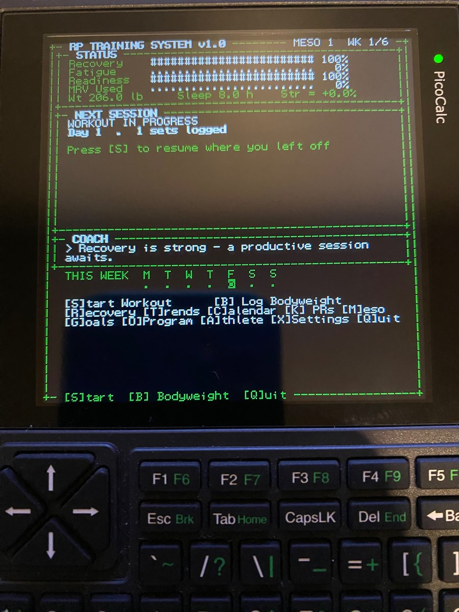
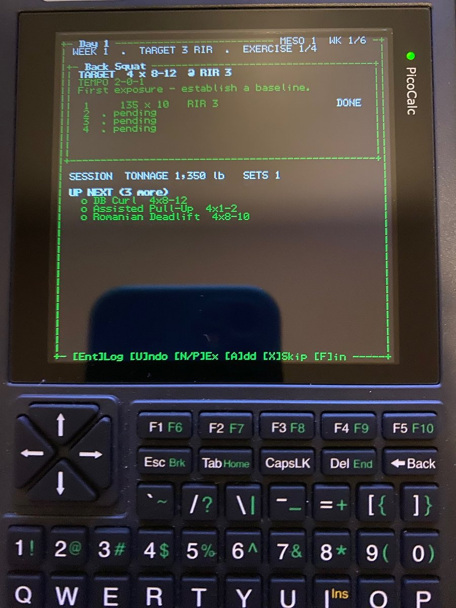
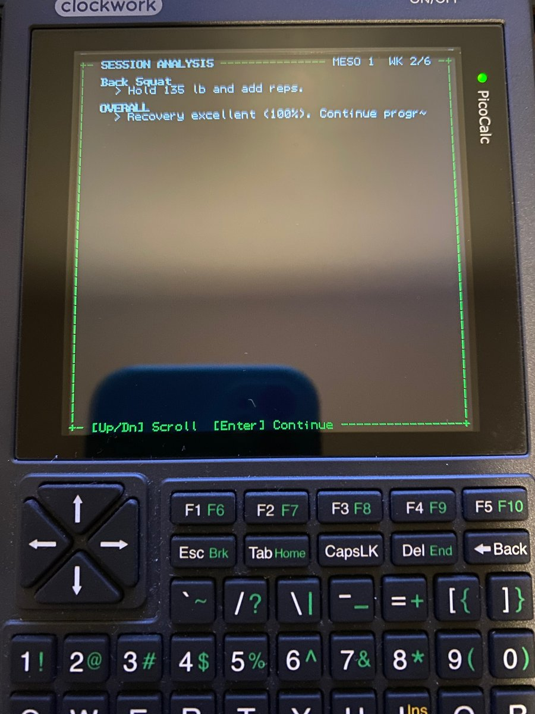
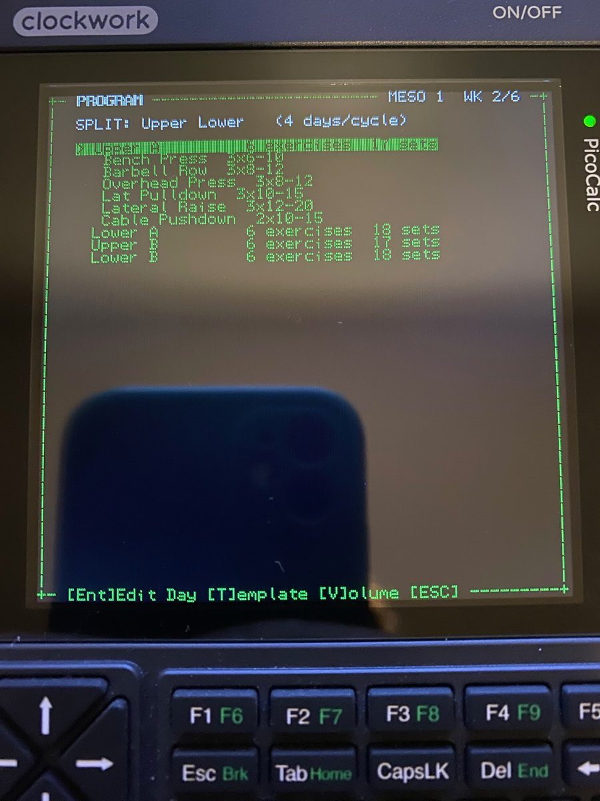

# RP TRAINING SYSTEM

[](https://github.com/Matthewjg95/picocalc-rp-trainer/actions/workflows/ci.yml)
[](LICENSE)

An offline, keyboard-first strength-training operating system with a
Renaissance Periodization (RP) auto-regulation coach, styled like a piece of
lab equipment. It runs **natively on a stock ClockworkPi PicoCalc** under
MicroPython — no phone, no companion app, no network — and on any desktop
terminal. Pure Python standard library, no dependencies.

### Running on the hardware

| Home dashboard | Logging a workout |
|---|---|
|  |  |
| Recovery / fatigue / readiness gauges, next session, and the coach's read on the day. | Target sets, reps and RIR per lift, live session tonnage, and what's up next. |

| Coach analysis | Program editor |
|---|---|
|  |  |
| After every session: what to change next time, and why. | Build and edit your split on-device; `[V]` checks it against MEV/MAV/MRV. |

## Run

```
python main.py
```

Requires Python 3.8+. Works on Windows 10+ (Windows Terminal or conhost),
Linux, macOS, and over SSH/serial.

### On a stock PicoCalc (100% standalone, no computer)

The same codebase runs under MicroPython on the stock Pico core, using the
PicoCalc MicroPython firmware's built-in 53x40 VT100 terminal for display
and its I2C keyboard driver for input. Build the SD payload and copy it to
the card:

```
python tools/build_sd.py        # produces build/sd/ (py + precompiled mpy)
# copy build/sd/* to the SD card root (see pico_sd/README_PICOCALC.txt)
# optionally copy build/sd/RP_Training_System.bin into the card's
# /firmware folder to get a named entry in the bootloader menu
```

Each boot, pick **RP_Training_System** (or `MicroPython`) in the bootloader
menu to reach the `>>>` prompt, then launch one of two ways:

**Works immediately (no setup):**

```
import sys; sys.path.insert(0, '/sd'); import rpts_boot
```

`/sd` is *not* on the import path by default, so the `sys.path.insert` is
required — a bare `import rpts_boot` only works after that setup has run
once in the same session.

**Shorter daily command (one-time setup):** run once —

```
import sys; sys.path.insert(0, '/sd'); import setup_go
```

— which writes a tiny `/go.py` launcher to internal flash. (Heads up: this
firmware may briefly *freeze the screen* while writing internal flash;
that's expected and harmless — just reset once if it does.) After that,
launch any time with just:

```
import go
```

Either way it reads only from the SD card at runtime, so it's safe and
fast, and the stock BASIC/NES/etc. firmwares stay available in the boot
menu.

**Why not auto-start?** This firmware bakes its own `boot.py`/`main.py`
into the image, so a filesystem `/main.py` is ignored — filesystem
auto-start isn't possible without rebuilding the firmware. (Do **not** run
an internal-flash installer: writing internal flash hangs the terminal on
this firmware. The SD-card launch above avoids that entirely.)

Since the Pico has no battery-backed clock across a reset, each boot shows
a quick date-confirm screen seeded from the last saved timestamp; within a
single power session the RP2040 clock keeps correct time, so relaunching
without a full reboot needs no re-confirm. `tools/check_upy.py` statically
verifies the shared modules stay MicroPython-clean.

Environment (desktop):

| Var | Meaning |
|---|---|
| `RPTS_DATA` | data directory (default `./data`) |
| `RPTS_COLS` / `RPTS_ROWS` | force a fixed screen size |

## What it does

Every coaching rule — e1RM math, volume landmarks, the fatigue model,
load/set progression, deloads, swaps — is documented in
[docs/COACHING.md](docs/COACHING.md).

- **RP mesocycles** — 4-8 week blocks, RIR ramps 3 → 3 → 2 → 1 → 0-1 →
  deload (half sets, ~90% load) automatically.
- **Auto-regulation** — every muscle tracks weekly sets against MEV/MAV/MRV
  landmarks (scaled by experience level). Sets are added when recovery is
  high and performance rises; pulled back on pain, missed reps, poor sleep,
  or MRV breach. Deloads trigger early if systemic fatigue spikes.
- **Load progression** — per-exercise suggestions driven by RIR accuracy
  and e1RM trend, with per-equipment increments. Every recommendation comes
  with its reason.
- **Check-ins** — sleep / stress / energy / motivation / joint pain /
  calories / protein / bodyweight before each session; RIR-accuracy and
  volume feedback after. All of it feeds the fatigue model.
- **Pain-driven swaps** — repeated pain on a lift suggests the RP swap
  chain (Back Squat → Hack Squat → Leg Press → …), filtered by your
  equipment.
- **Dashboards** — recovery gauges, engineering-telemetry trend sparklines,
  training calendar, mesocycle manager, PR board with lifetime-tonnage
  milestones and a celebration screen.
- **Data safety** — one JSON database, atomically written after every set;
  a paused workout survives a power cut and resumes on next boot. Rotating
  backups after each session, CSV export/import, lb/kg conversion of the
  entire archive.

## Keys

Global: hotkeys shown in each screen's bottom border. `ESC` backs out of
anything. Forms: `↑/↓` field, `←/→` nudge value or cycle choice, `Enter`
edit/save, or just start typing digits.

## Architecture

```
main.py               launcher
rpts/term.py          ANSI terminal driver: canvas, themes, diffed frames,
                      cross-platform key input (no curses)
rpts/widgets.py       frames, bars, gauges, sparklines, ascii fallbacks
rpts/exercise_db.py   exercise library, muscle targets, RP volume landmarks
rpts/programs.py      Upper/Lower, PPL, Full Body templates (all editable)
rpts/storage.py       JSON persistence, backups, CSV, unit conversion
rpts/analytics.py     pure functions: e1RM, tonnage, trends, PR detection
rpts/coach.py         RP engine: RIR schedule, fatigue model, progression,
                      deloads, swap suggestions, session analysis
rpts/app.py           screen stack, chrome, event loop, form toolkit
rpts/screens_*.py     UI screens (home / workout flow / dashboards)
tests/smoke.py        engine checks + scripted full-UI runs (python tests/smoke.py)
```

The layering is strict: `coach`/`analytics` never import UI; screens never
touch JSON directly. Future modules (wearables, plate calculator, macro
tracking, sync) plug in as new analytics inputs or screens without touching
the core.
